  

name: dashboard
on:
  schedule: [{ cron: "0 */6 * * *" }]
  workflow_dispatch:
permissions:
  contents: write
jobs:
  build:
    runs-on: ubuntu-latest
    steps:
      - uses: actions/checkout@v4
      - uses: actions/setup-node@v4
        with: { node-version: 22 }
      - run: node dashboard/generate.mjs
        env:
          VERCEL_TOKEN: ${{ secrets.VERCEL_TOKEN }}
          VERCEL_TEAM_ID: ${{ secrets.VERCEL_TEAM_ID }}
          RENDER_API_KEY: ${{ secrets.RENDER_API_KEY }}
      - run: |
          git config user.name "dashboard-bot"
          git config user.email "bot@users.noreply.github.com"
          git add dashboard.svg
          git diff --staged --quiet || (git commit -m "chore: atualiza dashboard" && git push)

          
