 

 

## `> whoami`

Desenvolvedor web focado em **sistemas SaaS**, **automação** e **interfaces modernas**.
Construo produtos do zero: do banco de dados ao deploy, com atenção a segurança, escalabilidade e experiência de uso.

- 🏥 Criador do **AgendFy**, plataforma de gestão e agendamento para clínicas (multiclínicas, com chatbot integrado)
- ⚙️ Automatizo fluxos e integro serviços para ganhar tempo e reduzir trabalho manual
- 🚀 Publico tudo em produção: hoje são **6 projetos online** (painel abaixo)

 

## `> stack`

 

## `> deploys`

Atualizado automaticamente a cada 30 minutos via GitHub Actions.

 

## `> projetos em destaque`

| Projeto | Descrição | Hospedagem |
| :-- | :-- | :-: |
| **AgendFy** | SaaS de agendamento e gestão para clínicas, com motor de documentos e isolamento multiclínicas | Render |
| **AgendFy Chatbot** | Atendimento automatizado integrado ao AgendFy | Render |
| **Nexora** | Projeto web (site estático) | Render |
| **OmniTask** | Gerenciador de tarefas | Render |
| **To-Do List** | Lista de tarefas | Render |
| **Linktree** | Página de links pessoal | Render |

<!-- Adicione os projetos da Vercel aqui, com link: [Nome](https://...) -->

 

## `> atividade`

 

## `> contato`

<!--  -->
<!--  -->

Feito com café, código e deploy contínuo.

